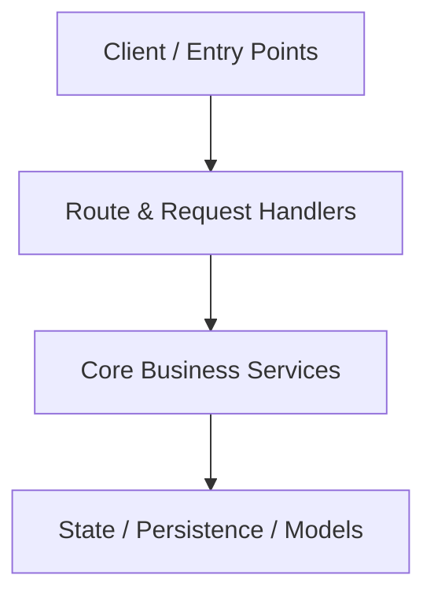

# ReadMyCode — Architecture & System Map

> Generated automatically by [ReadMyCode](https://readmycode.vercel.app)

## Technology Stack
- **Primary Language & Runtime**: Full-Stack (JavaScript/TypeScript + Python)
- **Monitored Source Files**: 365 indexed files

## System Topology



## Directory Organization
```text
action.yml
AGENTS.md
api/index.js
client/e2e/analyze.spec.js
client/e2e/demo.spec.js
client/e2e/landing.spec.js
client/e2e/navigation.spec.js
client/eslint.config.js
client/index.html
client/package-lock.json
client/package.json
client/playwright.config.js
client/postcss.config.js
client/public/badge.svg
client/public/favicon.svg
client/public/icons.svg
client/public/og.png
client/public/robots.txt
client/public/screenshots/01-hero-desktop.png
client/public/screenshots/02-generate-flow.png
client/public/screenshots/03-output-screen.png
client/public/screenshots/04-mobile-view.png
client/public/sitemap.xml
client/src/App.jsx
client/src/assets/hero.png
client/src/components/ApiDocsViewer/ApiDocsViewer.jsx
client/src/components/ArchitectureViewer/index.jsx
client/src/components/ArchitectureViewer/ReactFlowDiagram.jsx
client/src/components/common/AskAiDrawer.jsx
client/src/components/common/Avatar.jsx
... and 335 other source files
```
