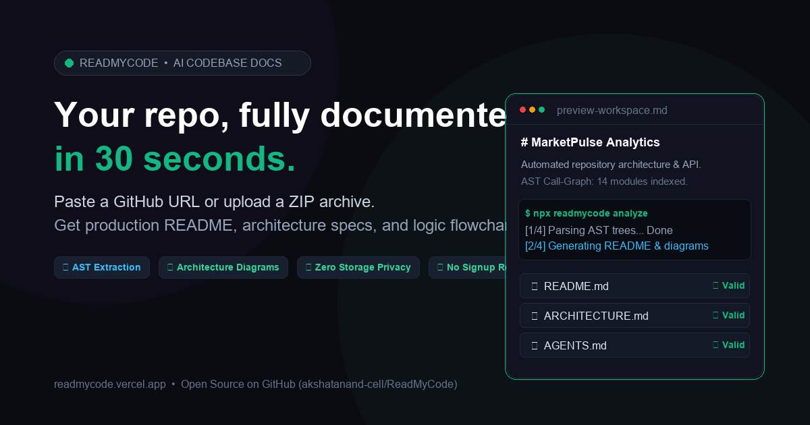

<div align="center">

# ReadMyCode

**Your repository, fully documented in 30 seconds.**  
Automated codebase intelligence, AST parsing, system topology mapping, and specification generation.

[](https://readmycode.vercel.app/)
[](LICENSE)
[](https://github.com/akshatanand-cell/ReadMyCode/stargazers)

<br />



</div>

---

## 💡 Overview

**ReadMyCode** analyzes public GitHub repositories and uploaded ZIP archives using Abstract Syntax Tree (AST) parsing and xAI Grok inference. It automatically synthesizes production specifications:

1. **README.md**: Comprehensive installation, quickstart, environment configuration, and project architecture overview.
2. **ARCHITECTURE.md**: System layering, module boundaries, network ingress, and persistence mapping.
3. **AGENTS.md**: Autonomous AI agent constitution, error contracts, and guardrails for coding assistants.
4. **TASK_BREAKDOWN.md**: Phased implementation sequencing with verifiable dependency paths.
5. **Flowchart & Topology**: Interactive Mermaid.js control-flow visualizations with zoom, pan, and PNG/SVG export.
6. **Function Index**: Multi-language AST signature extraction, parameter typing, and complexity analysis.
7. **Stack Trace Diagnosis**: AI-assisted error diagnosis and root cause analysis for stack traces.

---

## 🛠️ Unified Tech Stack

Matching our verified [System Architecture](./docs/ARCHITECTURE.md):

| Layer | Technology | Purpose |
| :--- | :--- | :--- |
| **Frontend** | React 18, Vite 5 | Single-page application with responsive layouts |
| **Styling** | Tailwind CSS 3 | Utility-first dark theme with emerald accents |
| **Typography** | Plus Jakarta Sans, JetBrains Mono | Optimal hierarchy and code block readability |
| **Diagrams** | Mermaid.js 10.9 | AST-derived flowcharts and architecture graphs |
| **Backend** | Express.js 4 (Node 18+) | Modular REST API server with rate limiting |
| **AI Engine** | xAI Grok (`grok-2-latest`) / GroqCloud | Structured LLM code analysis with AST fallback |
| **Database** | MongoDB Atlas (Mongoose 8) | Persistent document store with connection caching |
| **Security** | JWT + bcryptjs | Stateless token authentication with strict CORS |
| **Deployment** | Vercel Serverless Functions | Monorepo deployment with automated CI/CD |

---

## 🔒 Privacy & Data Retention

- **Transient Code Execution**: Source code cloned for analysis is processed ephemerally and deleted from `/tmp` immediately after AST extraction.
- **Persistent Specifications**: Only generated documentation, architecture maps, and user account metadata are stored in your private database.
- **Upload Size Limits**: ZIP uploads are constrained to 4 MB (aligned with serverless payload limits). For larger repositories, analyze via public GitHub URL.

---

## 🚀 Getting Started

### Prerequisites
- Node.js 18+
- MongoDB instance (local or [MongoDB Atlas](https://www.mongodb.com/atlas))
- xAI Grok API key (or GroqCloud API key)

### 1. Clone & Install Dependencies
```bash
git clone https://github.com/akshatanand-cell/ReadMyCode.git
cd ReadMyCode

# Install root, backend, and frontend dependencies
npm install
cd server && npm install
cd ../client && npm install
cd ..
```

### 2. Environment Variables
Create `server/.env`:
```env
PORT=5000
NODE_ENV=development
MONGO_URI=mongodb://127.0.0.1:27017/readmycode
JWT_SECRET=your_jwt_secret_key_here
JWT_EXPIRES_IN=7d
XAI_API_KEY=your_xai_grok_key_here
AI_MODEL=grok-2-latest
CLIENT_URL=http://localhost:5173
```

### 3. Start Development Servers
Run the full stack concurrently:
```bash
# From repository root
npm run dev
```
- Frontend UI: `http://localhost:5173`
- Backend API: `http://localhost:5000`

---

## 📁 Repository Structure

```
├── client/                     # React 18 Vite frontend
│   ├── public/                 # Static assets, favicon.svg, robots.txt, sitemap.xml, og.png
│   ├── src/
│   │   ├── components/         # ReadmeViewer, FlowchartViewer, ApiDocs, Debugger
│   │   ├── pages/              # Home, Analyze, RepoOverview, Dashboard
│   │   └── hooks/              # useRepoAnalysis, useAuth
├── server/                     # Express.js REST API
│   ├── config/                 # MongoDB connection & environment configuration
│   ├── controllers/            # Repo, docs, diagram, auth, and debug controllers
│   ├── middleware/             # Strict CORS, rate limiter, auth, and upload limits
│   ├── models/                 # Mongoose schemas (Repo, AnalysisResult, User)
│   └── services/               # Spec doc generators, GitHub cloning, AI services
├── docs/                       # Project documentation & specifications
│   ├── ARCHITECTURE.md         # System design, data flows, and component topology
│   ├── AGENTS.md               # Coding assistant rules and constitution
│   ├── PRD.md                  # Product Requirements Document
│   └── TASK_BREAKDOWN.md       # Phased roadmap and implementation checkpoints
├── scripts/                    # Development & utility scripts
│   ├── start-dev.bat           # Windows development startup
│   └── test-db.js              # Database connection diagnostic utility
└── examples/                   # Sample project archives for testing
    └── demo-project.zip        # Test Python/Node archive (under 4MB)
```

---

## 📜 Documentation & Specifications

- [System Architecture Specification](./docs/ARCHITECTURE.md)
- [Agent Constitution & Rules](./docs/AGENTS.md)
- [Product Requirements (PRD)](./docs/PRD.md)
- [Task Breakdown & Roadmap](./docs/TASK_BREAKDOWN.md)

---

## 👤 Author

**Akshat Anand**
- GitHub: [@akshatanand-cell](https://github.com/akshatanand-cell)
- Live Platform: [https://readmycode.vercel.app](https://readmycode.vercel.app)

---

## 📄 License
This project is open-source and licensed under the [MIT License](LICENSE).
